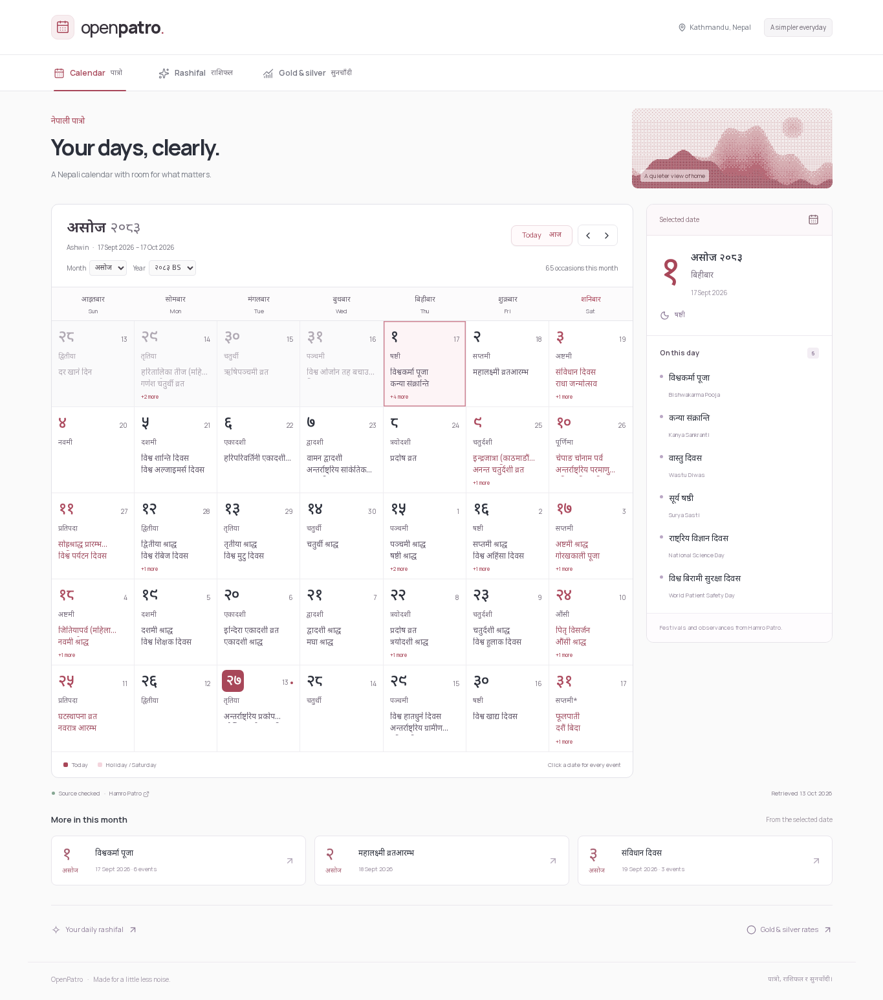
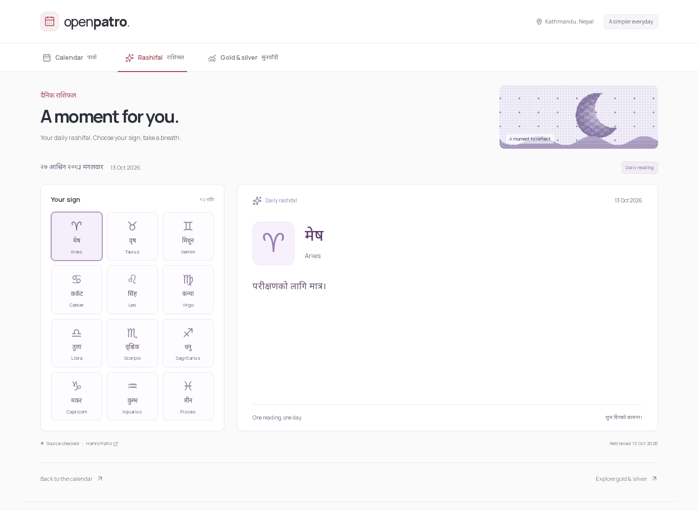
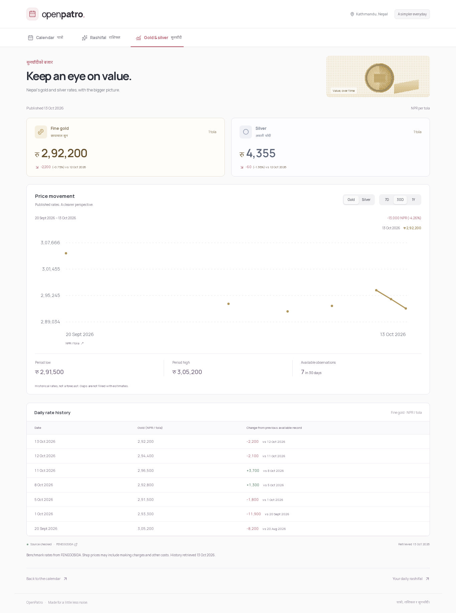
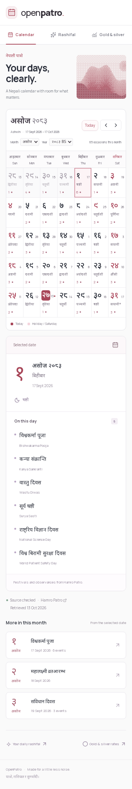

# OpenPatro

A simpler Nepali calendar, daily rashifal, and Nepal gold/silver dashboard.

## Why we made this

Sometimes you just want to check today's Nepali date, see what is happening on a particular day, or read your daily rashifal. Hamro Patro brings many useful services together, but for our needs its page has too much going on for those simple tasks.

We made OpenPatro to give those everyday details some breathing room: a readable calendar first, with just two additional sections we care about. No news feed, weather, forex, advertisements, or unrelated portal features.

## Why open source matters to us

We love open source: being able to read the code, understand a decision, fix a bug, and build something that fits your own needs.

Hamro Patro is a closed-source application as far as our investigation established: we found no publicly licensed source repository for its web application. We believe everyday Nepali calendar tools should have open-source implementations, documented interfaces, and clearly licensed datasets that general developers can use to build their own websites, apps, and integrations.

OpenPatro is our step toward that goal. We want developers to be able to inspect how it works, learn from it, contribute improvements, and self-host a simpler calendar. Our implementation is licensed under the [MIT license](LICENSE). See [third-party notices](THIRD_PARTY_NOTICES.md) for component attribution and upstream content boundaries.

Opening our implementation does not make upstream calendar events, horoscope text, or market data openly licensed. Their reuse terms remain a separate unresolved question. OpenPatro is an independent project and is not affiliated with Hamro Patro.

## What you can use

- **Nepali calendar:** BS dates with AD context, tithi, holidays, month/year navigation, and a Today shortcut. Select a date to read every event returned by the source, including events that do not fit inside a calendar cell.
- **Daily rashifal:** complete Nepali readings for all twelve signs, with their source date.
- **Gold and silver:** independently sourced Nepal benchmark rates in NPR per tola, with 7/30/365-day historical views, period changes, minimum/maximum values, and a price table. These charts describe observed history; they do not predict prices.

All three sections work without an account. The local MVP is implemented; results are recorded in [verification](docs/verification.md).

## Screenshots

Captured from our locally built application during browser verification on 13 October 2026. These previews use fixed test data, including synthetic rashifal text and a limited set of historical market observations; they are interface demonstrations, not current readings or prices.

### Nepali calendar



### Daily rashifal



### Gold and silver



### Mobile calendar



## How we built it

We started by investigating Hamro Patro's public HTML, shipped JavaScript, and visible calendar behavior using the reverse-engineer-anything skill, the REA MCP static analyzer, direct HTTP inspection, and browser checks.

The useful discovery was an embedded `hp-bootstrap` JSON payload containing paired BS/AD dates, tithi, holiday wording, and individual event arrays. Public month pages provide the calendar grids, and the rashifal page provides twelve dated readings. Our server adapters extract that JSON as inert text and normalize it for our own interface. We do not execute upstream scripts or inject upstream HTML.

REA's semantic analysis was partial because its JavaScript worker exhausted its heap. Direct response inspection and browser verification supplemented that work. We did not recover Hamro Patro's private backend or recreate its astronomical calculations. The calendar currently depends on the date mappings and events returned by Hamro Patro. See the [source investigation](docs/patro-sources.md) and [evidence ledger](findings.md).

For metals, we investigated [FENEGOSIDA](https://www.fenegosida.org/) independently through its shipped client and public JSON responses. Its published Nepal rates and dated history drive our own dashboard; we do not substitute converted global spot prices or invent missing records. This investigation did not use REA. See [metals source research](docs/metals-sources.md).

The frontend and backend live in one Next.js App Router application. Server-only adapters fetch and validate source records with Zod; our pages and API routes consume normalized data. Saved valid snapshots allow clearly dated fallback during source failures, and date rollover uses `Asia/Kathmandu`.

## Installation

### Requirements

- Node.js 20.9 or newer; verified locally with Node.js 22.22.2 and npm 10.9.7.
- Git to clone the repository.
- npm and an internet connection for dependencies, the initial font build, and live source data.

Clone the project and enter its directory:

```bash
git clone https://github.com/uzuw/openpatro.git
cd openpatro
npm ci
cp .env.example .env.local
```

Generate an authentication secret:

```bash
openssl rand -base64 32
```

Paste the output into `AUTH_SECRET` in `.env.local`. Keep `AUTH_URL=http://localhost:3001` for the default local setup. GitHub credentials can remain empty; sign-in is optional. Keep `.env.local` private.

Start the development server:

```bash
npm run dev
```

Open [http://localhost:3001](http://localhost:3001). The app uses port 3001 and binds to the local loopback interface.

- `/` — Nepali calendar
- `/rashifal` — daily readings
- `/metals` — gold/silver rates and history

To run a production build locally, stop the development server first, then run:

```bash
npm run build
npm run start
```

The production server uses the same local address and port. Live data requires reachable upstream sources; without a valid saved snapshot, a failed source is shown as unavailable.

## Stack and assets

Next.js 16 App Router, React, TypeScript, NextAuth v5, Tailwind CSS 4, Framer Motion, Zod, next/font, next/image, Playwright, ESLint and Prettier. Dependencies are pinned by `package-lock.json`. Manrope and Noto Sans Devanagari are self-hosted through next/font. NextAuth v5 currently uses the pinned beta release.

The button and tabs are adapted from the actual [Obsidian UI registry](https://www.obsidianui.dev/components), with MIT attribution in [THIRD_PARTY_NOTICES.md](THIRD_PARTY_NOTICES.md). Three original SVG dither illustrations are generated by `node scripts/generate-art.mjs`. No Hamro Patro application assets are copied into the UI.

## Optional sign-in

All three pages work without an account. GitHub sign-in is enabled only when `AUTH_SECRET`, `AUTH_GITHUB_ID`, and `AUTH_GITHUB_SECRET` are configured in `.env.local`. Generate a local secret with `openssl rand -base64 32` and paste it into that ignored file. Set `AUTH_URL` to the application's actual origin. For local OAuth, use `localhost` consistently in the browser and callback registration: Next.js normalizes loopback addresses to this hostname in authentication requests. For the default local origin, the GitHub OAuth callback is `http://localhost:3001/api/auth/callback/github`.

`/sign-in` explains when optional sign-in is unconfigured. Sessions use signed/encrypted JWT cookies; no user database or personal preference backend is added. External OAuth completion needs your GitHub application credentials and is not covered by the local tests.

## Data and reliability

Server-only adapters extract inert public Hamro Patro bootstrap JSON and read FENEGOSIDA public JSON. Zod validates source records before replacing atomically persisted normalized snapshots. Defaults use ignored `.cache/OpenPatro`; `OPENPATRO_CACHE_DIR` can point to a persistent writable directory. Requests have a 12-second timeout, bounded bodies, in-flight deduplication and a one-minute failure backoff. Source and retrieval dates stay separate; outages show clearly dated saved data or an unavailable state.

This is a single-instance local Node service. Choose shared persistent storage before using ephemeral or multiple server instances. Source contracts are undocumented, coverage of every calendar year/event is not independently proven, and content reuse terms remain unresolved before public release. No public deployment has been made.

## Checks

```bash
npm run typecheck
npm run lint
npm run format:check
npm test
npm run build
npx playwright install chromium
npm run test:e2e
# Additional live comparison (start the normal app first):
npm run test:live
```

Playwright starts the production build on loopback ports 3002 and 3004 (optional auth configuration uses dummy test credentials and never completes external OAuth) with an isolated cache and explicit test-only source/clock preload. Build first. The preload never enters production and tests do not serve investigation snapshots as product fallback. Unit/browser fixtures are minimized dated source records; horoscope fixture prose is explicitly synthetic. Live source comparisons are additional point-in-time verification, not a replacement for repeatable tests.

## Documents

| Document                                           | Purpose                                          |
| -------------------------------------------------- | ------------------------------------------------ |
| [AGENTS.md](AGENTS.md)                             | Authorized phase, scope and agent rules          |
| [Requirements](docs/requirements.md)               | Product flows and acceptance criteria            |
| [Architecture](docs/architecture.md)               | Implemented service, source boundaries and cache |
| [Contracts](docs/data-contracts.md)                | Normalized API contracts                         |
| [Implementation plan](docs/implementation-plan.md) | Milestones and verification gates                |
| [Design](docs/design.md)                           | Visual direction and responsive behavior         |
| [Verification](docs/verification.md)               | Current evidence and remaining limitations       |
| [Calendar/rashifal sources](docs/patro-sources.md) | Public-source observations and REA limits        |
| [Metals sources](docs/metals-sources.md)           | Independent quotes, units and history            |
| [Task plan](task_plan.md)                          | Current checklist                                |
| [Findings](findings.md)                            | Evidence ledger and open questions               |
| [Progress](progress.md)                            | Historical work log                              |
