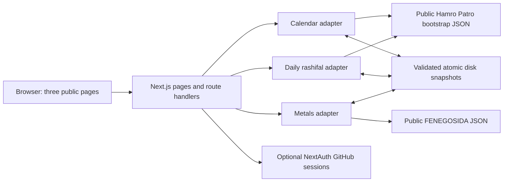

# OpenPatro architecture

Implemented after the user's 2026-10-13 stack request. Next.js App Router replaces the original proposed Vite/Fastify split; one service serves the pages and normalized API. Public deployment is outside this task.

## Shape



## Stack

| Layer           | Choice                                                                 | Purpose                                                                                        |
| --------------- | ---------------------------------------------------------------------- | ---------------------------------------------------------------------------------------------- |
| Service         | Next.js 16 App Router, React, TypeScript                               | Server-rendered first load, streaming loading state, client interactions, three route handlers |
| UI              | Tailwind CSS 4, shared CSS tokens, actual Obsidian UI button/tabs      | Original balanced layout and small accessible controls                                         |
| Animation       | Framer Motion                                                          | Restrained page/sign transitions and active navigation; respects reduced motion                |
| Typography/art  | next/font, next/image, original ordered-dither SVGs                    | Self-hosted Manrope/Devanagari fonts and local decorative art                                  |
| Validation      | Zod                                                                    | Request and source boundary checks plus normalized snapshot validation                         |
| Auth            | NextAuth v5 beta, optional GitHub provider, JWT session                | Optional sign-in, sign-out, same-origin redirects; core pages always public                    |
| Transport/store | Native fetch, Node filesystem                                          | Bounded server requests and atomic normalized JSON snapshots                                   |
| Verification    | Node test runner through tsx, Playwright, TypeScript, ESLint, Prettier | Source/date/money/cache correctness and actual production-page interactions                    |

`package-lock.json` pins the tested dependencies. Node 22.22.2 was used locally. No second web server framework, ORM, queue, scheduled scraper or user database is present.

## Boundaries

`src/lib/sources/patro.ts` shares inert bootstrap extraction between calendar and rashifal while validating them separately. Calendar reads actual paired BS/AD records and preserves every event and regional qualifier. Rashifal requires twelve unique known signs, complete Nepali text and a verified reading date; unavailable English remains null.

`src/lib/sources/metals.ts` independently validates federation quotes and history, selects explicit fine-gold/silver per-tola rows, and reconciles dated observations without filling gaps. Quote and history have separate caches and retrieval timestamps. More recently retrieved values take precedence for conflicting history points, with a visible revision warning.

`src/lib/contracts.ts` defines the normalized contracts. Route handlers validate calendar query parameters before source fetching and translate failures into safe JSON responses. Client components never receive raw source HTML or use an arbitrary URL proxy. Upstream text is rendered as text. `evidence/` and test fixtures are not product imports.

Pages fetch initial data on the server. Each client view keeps its own failure/loading/selection state. `useData` rechecks after 15 minutes, on Nepal date changes, and on returning to a visible tab, with abort/sequence guards against stale responses. A failed month request keeps the successfully displayed month and allows retry. Source failures leave the other sections usable.

## Date and cache rules

Gregorian keys use `YYYY-MM-DD`; BS fields stay separate. `Asia/Kathmandu` determines Today and source publication dates. Date-only formatting uses UTC to avoid a device timezone shifting a day. BS month lengths and conversions come from the source, never a fixed offset.

| Data                           | Refresh TTL                              | Failure behavior                                                      |
| ------------------------------ | ---------------------------------------- | --------------------------------------------------------------------- |
| Parameterless current calendar | 1 hour, invalidate on Nepal rollover     | Saved current-month mapping is checked against today's AD date        |
| Explicit BS month              | 24 hours                                 | Fall back only to the matching validated month                        |
| Daily rashifal                 | 15 minutes, invalidate on Nepal rollover | Original reading date retained; old/unverified content is stale       |
| Metals quote                   | 15 minutes, invalidate on Nepal rollover | Original bulletin date and previous available comparison retained     |
| Metals history                 | 6 hours                                  | Independent retrieval/freshness preserved when quote refresh succeeds |

Default snapshots are in `.cache/OpenPatro`, overridable with `OPENPATRO_CACHE_DIR`. One in-flight request per cache key, bounded memory, 12-second fetch timeout, 5 MB body limit and one-minute failure backoff bound source traffic. Validated envelopes are written to a temporary file then atomically renamed. Missing/corrupt snapshots are discarded; invalid refreshes never replace successful data. If disk persistence fails, the UI receives a warning that restart fallback is unavailable.

`fetchedAt` means successful retrieval; `checkedAt` means refresh attempt. Reading disk does not make old content newly fetched. Quote and history failures remain independent. Refresh is request-driven; there are no scheduled jobs.

## Security and local hosting

Development/production commands bind to loopback port 3001. NextAuth needs a locally generated `AUTH_SECRET` and an explicit `AUTH_URL`; GitHub credentials are optional. Secrets are ignored and never exposed through client props. GitHub sign-in and sign-out use NextAuth server actions and framework CSRF protections. Redirects are restricted to the application origin.

All routes set nosniff, DENY framing, strict-origin referrer policy, disabled camera/microphone/geolocation and a same-origin CSP. Production also sets HSTS. CSP permits inline scripts/styles for Next.js hydration and animation; this is a baseline policy, not a nonce-based strict CSP. Development additionally allows eval and websocket connections for framework tooling.

The local target is one Node service with a writable cache directory. Before public hosting, decide source reuse terms, request throttling, TLS/origin settings and storage appropriate to the host. File snapshots are insufficient for ephemeral or multiple instances without shared storage.

## Layout

```text
src/app/                   App Router pages, errors, loading, CSS, API routes
src/auth.ts                NextAuth setup and server helpers
src/components/            calendar, rashifal, market, shell and shared states
src/components/ui/         MIT Obsidian UI button and tabs
src/hooks/use-data.ts       client refresh/race handling
src/lib/contracts.ts       canonical normalized Zod contracts
src/lib/sources/            server-only source adapters and bounded fetch
src/lib/cache.ts            validated persistent cache
src/lib/date.ts, market.ts  date formatting and observed-history summaries
public/art/                three original SVG illustrations
scripts/generate-art.mjs   repeatable Bayer-dither artwork generator
tests/                     minimized fixtures, unit tests and browser checks
docs/                      requirements, decisions, research and verification
evidence/                  ignored investigation material
```

Source endpoints are undocumented and source fidelity is not independent astronomical/editorial validation. The application does not recover Hamro Patro's private backend or assert an upstream content license. See source notes for retained REA Evidence and its partial semantic coverage.
